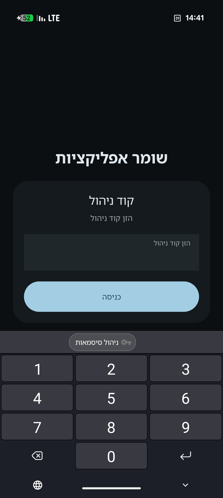
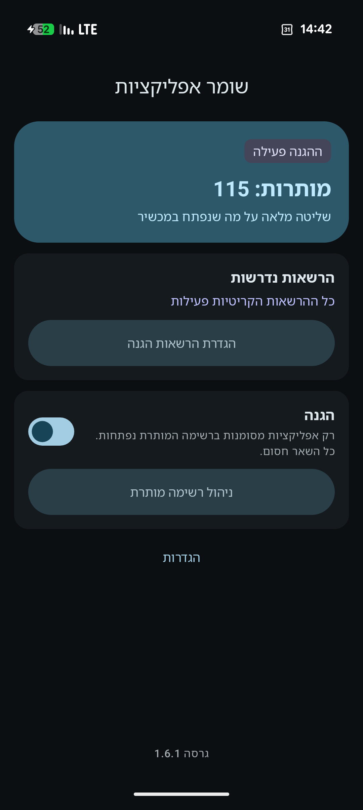
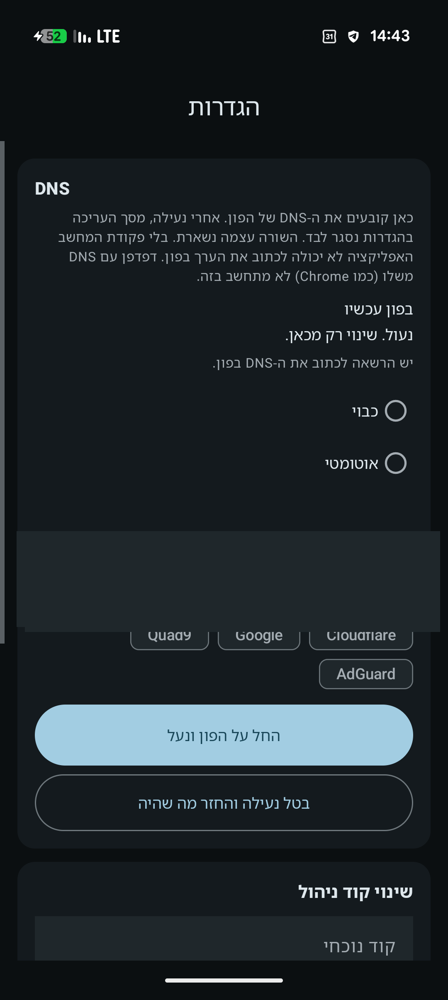

# שומר אפליקציות

<p align="center">
  
  
  
</p>

<p align="center">
  
  
  
  <br>
  <sub>כניסה · ראשי · DNS</sub>
</p>

אפליקציה ל-Pixel. נפתח רק מה שסומן ברשימה, ועל הדרך אי אפשר לשנות את ה-DNS מההגדרות של הפון.

בלי Device Owner. על המסך זה עובד כמו Kaspersky Safe Kids: נגישות, קוד, ומסך חסימה מעל האפליקציה.

## איך מפעילים

1. מתקינים ובוחרים קוד, 4 עד 8 ספרות.
2. מצלמים את קוד השחזור. הוא מוצג פעם אחת, ואפשר איתו להחליף קוד שנשכח.
3. באשף מאשרים את כל ההרשאות.
4. מסמנים מה מותר ולוחצים «אשר».

> [!NOTE]
> לפני «אשר» אין חסימה, וגם בזמן האשף ההגדרות נשארות פתוחות.
> יציאה מהאפליקציה נועלת אותה. בכניסה הבאה צריך שוב את הקוד.

## מה נפתח

| מצב | תוצאה |
| --- | --- |
| מסומן ברשימה | נפתח |
| לא מסומן | לא נפתח |
| אפליקציה שזה עתה הותקנה | לא נפתח, עד שמסמנים אותה |
| הגדרות, מסך הבית, מקלדת, Play, חשבון גוגל, השומר | נפתחים תמיד |

גלישה ב-Play פתוחה. מה שהורד משם עדיין צריך סימון.

## הסרה

פרטי אפליקציה נפתחים, כולל של השומר. לחיצה ארוכה על האייקון במסך הבית לא מבקשת קוד.

| פעולה | תוצאה |
| --- | --- |
| הסרה, סגירה ידנית, ארכיון או השבתה של השומר | נדרש קוד |
| ביטול מנהל המכשיר או כיבוי הנגישות שלו | נדרש קוד |
| קוד נכון | כ־45 שניות להשלים בהגדרות. הרשימה נשארת דלוקה |
| «נעל שוב» בהגדרות האפליקציה | החלון נסגר |
| וויי-פיי, חיפוש בהגדרות, חשבון גוגל | לא נחסם |

> [!NOTE]
> עם ADB אפשר לעקוף את זה. מהמסך, בלי הקוד, ההסרה לא עוברת.

## DNS

> [!IMPORTANT]
> שינוי DNS חסום. מההגדרות של הפון המסך נסגר מיד, בלי קוד. משנים את השרת רק מתוך השומר.

בהגדרות של השומר בוחרים כבוי, אוטומטי, או שם שרת. יש קיצור ל-Cloudflare, Google, Quad9 ו-AdGuard.

«החל על הפון ונעל» כותב את הבחירה ל-Private DNS. שינוי שנעשה אחר כך נכתב חזרה. «בטל נעילה» מחזיר את הערך שהיה לפני כן.

השורה בהגדרות הפון נשארת, אי אפשר למחוק אותה. וויי-פיי ושאר הדף לא נחסמים.

> [!IMPORTANT]
> מזינים שם שרת, למשל `dns.google` או `one.one.one.one`. כתובת כמו `8.8.8.8` לא מתקבלת.
>
> כדי שהערך ייכתב בפון, פעם אחת אחרי ניפוי USB:
>
> ```bash
> adb shell pm grant com.appguard.blocker android.permission.WRITE_SECURE_SETTINGS
> ```
>
> בלי הפקודה המסך רק נסגר.

> [!WARNING]
> Chrome עם Secure DNS משלו לא משתמש בהגדרה הזאת.

## הרשאות

כולן נדרשות לפני שההגנה נדלקת.

| הרשאה | בשביל מה |
| --- | --- |
| נגישות | לזהות מה נפתח, ולעצור הסרה |
| גישה לשימוש | גיבוי, אם הנגישות פספסה |
| מנהל מכשיר | להקשות על הסרה |
| הצגה מעל אפליקציות | מסך החסימה |
| התעלמות מסוללה | שהשירות ברקע לא ייסגר |
| התראות | ההתראה של שירות הרקע |
| הפעלה אוטומטית | רק אצל יצרנים שיש להם מסך כזה |

## בנייה

```bash
./gradlew assembleDebug
```

ה-APK:

```text
app/build/outputs/apk/debug/app-debug.apk
```

מקרי קצה והתנהגות מפורטת: [docs/SPEC.md](docs/SPEC.md)
